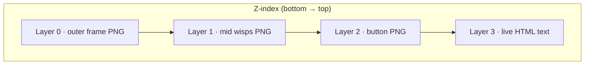

# Console CTA v3 · Layered Cutout Spec

> **Status:** Assets + draft CSS only — not wired to `index.html`.  
> **Scope:** `.workbench__cta--console` footer in `frontend/index.html` (开始游戏 panel).  
> **Design intent:** Quieter than v2; healing pastel palette; **层次感** via transparent PNG stack.

## Asset Inventory

| ID | File | Size | Alpha | Role |
|----|------|------|-------|------|
| `console-outer-frame-v3` | `images/workbench/console-outer-frame-v3.png` | 1200×400 | **Yes** | Layer 0 — parchment/glass border ring; hollow center |
| `console-layer-mid-v3` | `images/workbench/console-layer-mid-v3.png` | 1200×400 | **Yes** | Layer 1 — feather/star wisps between frame and button |
| `console-start-btn-v3` | `images/workbench/console-start-btn-v3.png` | 480×140 | **Yes** | Layer 2 — raised sakura/sky button chrome; live text in DOM |
| `console-full-mockup-v3` | `images/workbench/console-full-mockup-v3.png` | 1200×400 | No | Reference mockup (baked text); QA / side-by-side only |

All four registered in `frontend/images/manifest.json` (`ui[]`, `source: generated`).

## Z-Order Diagram

```
┌─────────────────────────────────────────────────────────────┐
│  Layer 3 · HTML text (top)                                  │
│    .workbench__cta-note  ·  .new-game__zh / .new-game__en   │
├─────────────────────────────────────────────────────────────┤
│  Layer 2 · Button chrome                                    │
│    .workbench__new-game  →  console-start-btn-v3.png        │
├─────────────────────────────────────────────────────────────┤
│  Layer 1 · Mid wisps (optional depth)                       │
│    .workbench__cta--console::before  →  console-layer-mid-v3│
├─────────────────────────────────────────────────────────────┤
│  Layer 0 · Outer frame (bottom)                             │
│    .workbench__cta--console  →  console-outer-frame-v3.png  │
└─────────────────────────────────────────────────────────────┘
         ▲ transparent cutouts stack over workbench background
```

### Mermaid (stack)



## Integration vs v2

| Aspect | v2 | v3 |
|--------|----|----|
| Outer panel | Opaque baked panel | **Transparent cutout** frame |
| Mid layer | None | Feather/star wisps PNG |
| Button | 480×120 flat chrome | **480×140** raised depth chrome |
| Palette | Parchment + gold accents | Sakura/sky healing tokens |
| Depth | Single-plane | 4-layer stack |

Prefer **L0 + L1 + L2 + live HTML** over `console-full-mockup-v3.png`.

## CSS Wiring

Draft (not linked): `frontend/css/console-v3-draft.css`  
Production target when ready: `frontend/css/workbench-console-cta.css`  
Bump `frontend/index.html`: `workbench-console-cta.css?v=3` + image `?v=3`.

### Selectors (from `workbench-console-cta.css`)

| Selector | v3 role |
|----------|---------|
| `.workbench__cta--console` | Layer 0 background; remove dark glass gradient |
| `.workbench__cta--console::before` | Layer 1 mid wisps (replaces gold corner TL) |
| `.workbench__cta--console::after` | **Disabled** — corners/glow in frame art |
| `.workbench__cta-note` | Layer 3 note line |
| `.workbench__new-game` | Layer 2 button PNG; drop gold gradient |
| `.new-game__zh`, `.new-game__en` | Layer 3 button copy |
| `@keyframes console-cta-breathe` | Retarget glow to `--sakura-soft` / `--sky-soft` |

## HTML Structure (unchanged)

```html
<footer class="workbench__cta workbench__cta--console" aria-label="开始游戏">
  <p class="workbench__cta-note">AI 将为你构筑独一无二的分支剧情世界</p>
  <button type="button" id="create-btn" class="workbench__new-game …">
    <span class="new-game__row"><span class="new-game__zh">开始游戏</span></span>
    <span class="new-game__en">NEW GAME</span>
  </button>
</footer>
```

No markup changes required. Mid layer uses `::before` pseudo-element.

## Responsive Notes

| Breakpoint | Action |
|------------|--------|
| Default | `width: min(100%, 520px)`; art aspect ~3:1 |
| `max-width: 640px` | Full width; keep `background-size: 100% 100%` on all layers |
| Short viewports | `min-height: clamp(148px, 19vh, 196px)` for note + taller button |

## QA Checklist (when wiring)

- [ ] Frame center truly transparent — workbench bg shows through
- [ ] Mid wisps visible but subtle (not competing with button)
- [ ] Button text contrast ≥ 4.5:1 on sakura/sky chrome
- [ ] `:focus-visible` ring visible on layered button
- [ ] `.is-loading` dims button; breathe animation uses pastel glow
- [ ] `prefers-reduced-motion: reduce` disables breathe + hover scale
- [ ] No double corners from old `::after` rules
- [ ] `?v=3` on CSS + all four image URLs

## Tokens Reference

From `frontend/css/tokens.css`: `--sky`, `--sky-soft`, `--sakura`, `--sakura-soft`, `--meadow`, `--ink`, `--ink-muted`, `--vn-text-muted`.

Replace gold/dark glass palette from v1 CSS with these when implementing.

## Variant: Full Mockup

`console-full-mockup-v3.png` is **design reference only**:

- Compare layered live stack vs baked mockup before ship
- Not recommended as single-layer fallback (loses real button semantics)
